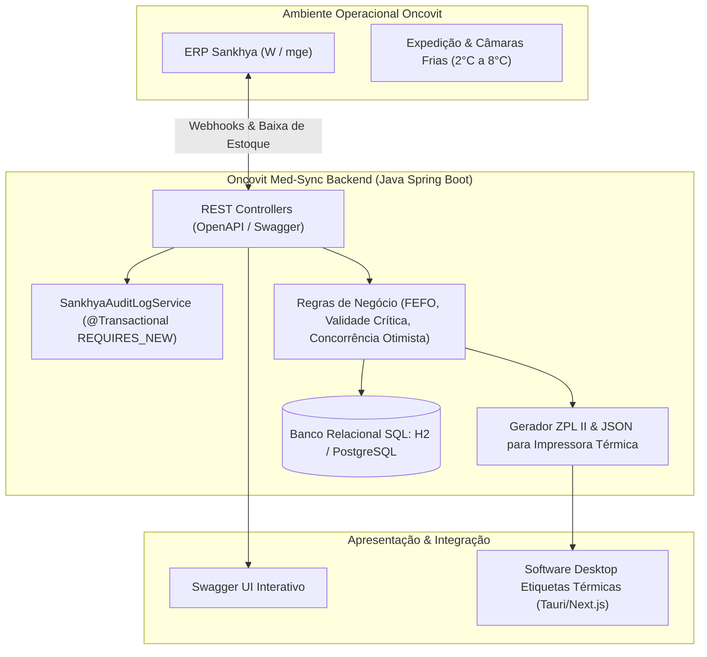

# Oncovit Sankhya Med-Sync & Gestão Farmacêutica

> **Projeto Técnico Especializado & Dossiê de Candidatura**  
> Desenvolvido por **Celso Ladislau Junior** ([@celsojuniorladislau](https://github.com/celsojuniorladislau))  
> Vaga: **Estagiário (Departamento de Desenvolvimento)** — Oncovit Distribuidora de Medicamentos (Vitória - ES)

---

## 🎯 Sobre o Projeto

O **Oncovit Sankhya Med-Sync** é um microsserviço em **Java (Spring Boot)** com banco de dados relacional **SQL** desenvolvido sob medida para simular os desafios logísticos e operacionais da **Oncovit Distribuidora de Medicamentos**, integrando-se aos processos do **ERP Sankhya**.

O projeto resolve três problemas de missão crítica:
1. **Rastreabilidade e Cadeia de Frio (2°C a 8°C):** Monitoramento de medicamentos termolábeis e oncológicos de alto custo.
2. **Prevenção de Perdas por Validade (FEFO):** Detecção proativa e alertas para lotes com validade crítica (< 60 dias).
3. **Ponte Direta com Expedição & Etiquetas Térmicas:** Geração de carga de dados e comandos ZPL II compatíveis com o software desktop de impressão térmica ([`sistema-de-impressao-de-etiquetas`](https://github.com/celsojuniorladislau/sistema-de-impressao-de-etiquetas)).

---

## 🏗️ Arquitetura do Sistema



---

## 📊 Estrutura do Repositório

* **[`oncovit-sankhya-med-sync/`](./oncovit-sankhya-med-sync/)**: Código-fonte Java Spring Boot, controladores, entidades JPA, testes unitários e de integração.
* **[`database/`](./database/)**: Scripts DDL, DML (com sementes de medicamentos oncológicos reais como Trastuzumabe, Pembrolizumabe, Rituximabe) e consultas SQL avançadas.
* **[`dossie-candidatura/`](./dossie-candidatura/)**:
  * `01_curriculo_otimizado_gupy.md`: Currículo otimizado com pontuação máxima para o algoritmo Gaia da Gupy.
  * `02_guia_abordagem_presencial.md`: Roteiro passo a passo para entrega presencial do currículo e pitch de 60 segundos com o gestor de TI.
  * `03_guia_teste_tecnico_resolvido.md`: Guia de estudo preparatório com questões resolvidas de Java e SQL para o teste presencial.
* **`test_e2e_suite.py`**: Suíte de 83 testes automatizados de ponta a ponta com 100% de aprovação.

---

## 🚀 Como Executar

### Pré-requisitos
* Java 17+ e Maven (ou Docker)

### Via Maven / Local:
```bash
cd oncovit-sankhya-med-sync
./mvnw spring-boot:run
```

Acesse a documentação interativa em: `http://localhost:8080/swagger-ui/index.html`

---

## 🧪 Cobertura de Testes
- **54 Testes Maven (Unitários e de Integração):** 100% aprovados sem falhas.
- **83 Testes E2E Automatizados:** 100% aprovados cobrindo endpoints, auditoria transacional e concorrência otimista.
